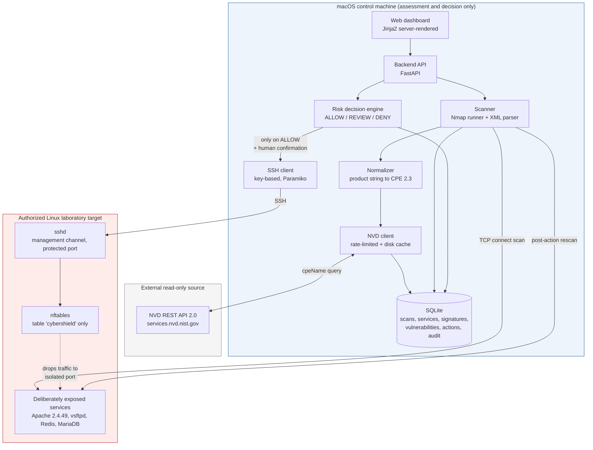
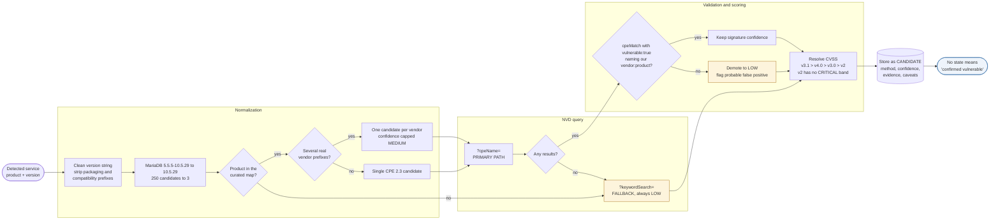
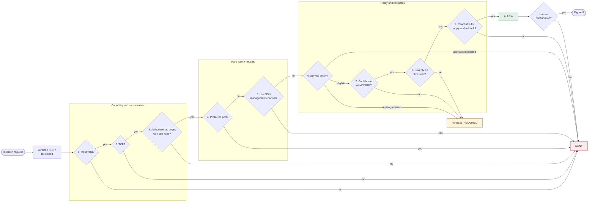
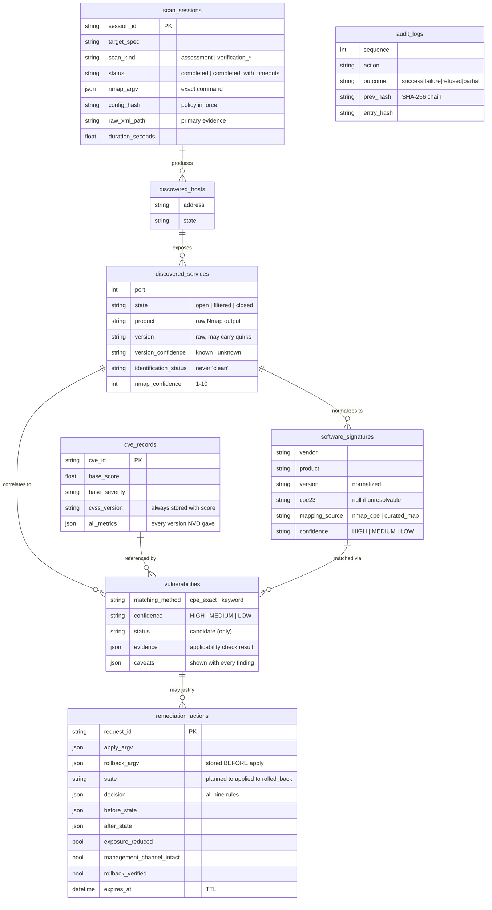

# CyberShield — Figures

Six figures for the research paper (spec §24). Each is authored in Mermaid so
it stays version-controlled and editable alongside the code it describes.

**Rendered exports** are committed in [`figures/`](figures/) as both SVG
(vector, preferred for print) and PNG. They were produced with:

```bash
npx -y @mermaid-js/mermaid-cli -i docs/figures.md -o docs/figures/figure.svg
```

Captions are written to stand alone, as a reader encountering the figure out of
context will need them to.

### Placement guidance

Rendered proportions differ, which affects how each fits on a page:

| Figure | Rendered | Shape | Suggested placement |
|---|---|---|---|
| 1 | 1677 x 1284 | balanced | Inline, single column or full width |
| 2 | 1784 x 271 | wide strip | Full page width, landscape |
| 3 | 1784 x 394 | wide | Full page width, landscape |
| 4 | 1784 x 616 | landscape | Full page width |
| 5 | 1784 x 173 | wide strip | Full page width, landscape |
| 6 | 1351 x 2445 | portrait | Full page, portrait |

Figures 2, 3 and 5 are process chains and render as wide strips; they read best
spanning the full text width. Use the SVGs so they stay sharp at any scale.

---

## Figure 1 — Overall CyberShield Architecture

**Caption.** Figure 1: Overall CyberShield architecture. The macOS control
machine performs all assessment and decision logic; firewall enforcement occurs
only on the authorized Linux laboratory target, reached over an SSH management
channel. The macOS host is never a remediation target — no local firewall
execution path exists in the codebase. The scanner and the enforcement point are
deliberately separated so that assessment cannot alter the system it measures.



---

## Figure 2 — Vulnerability Detection Workflow

**Caption.** Figure 2: Vulnerability detection workflow, from authorization
check to stored evidence. Authorization is evaluated before any packet is sent,
and a refused target produces an audit record without invoking Nmap. Absence of
a detected version yields an `undetermined` classification rather than a clean
result, and a scan truncated by the per-host timeout is recorded as
`completed_with_timeouts` so a partial result cannot be read as an exhaustive
one.

```mermaid
flowchart LR
    START(["Scan request<br/>for target T"]) --> AUTHZ

    subgraph AUTH["Authorization — before any packet"]
        direction TB
        AUTHZ{"AUTHORIZATION.md<br/>signed?"} -->|yes| SCOPE{"T inside an<br/>authorized range?"}
    end

    subgraph EXEC["Execution"]
        direction TB
        PROFILE["Load named profile<br/>raw Nmap flags never accepted"] --> RUN["Run Nmap<br/>argv array, shell=False,<br/>mandatory timeout"]
        RUN --> RAW[("Raw XML written<br/>before parsing")]
    end

    subgraph PARSE["Parsing and classification"]
        direction TB
        PARSED["Parse with defusedxml<br/>banners are untrusted"] --> TIMEOUT{"Any host<br/>timedout=true?"}
        TIMEOUT -->|yes| PARTIAL["completed_with_timeouts<br/>audit outcome = partial"]
        TIMEOUT -->|no| OK["completed"]
        PARTIAL --> CLASSIFY{"Version reported?"}
        OK --> CLASSIFY
        CLASSIFY -->|"product + version"| IDENT["identified<br/>version_confidence = known"]
        CLASSIFY -->|"product only"| PONLY["product_only"]
        CLASSIFY -->|neither| UNDET["undetermined<br/>NOT 'clean'"]
    end

    SCOPE -->|yes| PROFILE
    RAW --> PARSED
    IDENT --> STORE
    PONLY --> STORE
    UNDET --> STORE[("Persist hosts, services<br/>and evidence manifest")]
    STORE --> DONE(["Ready for correlation"])

    AUTHZ -->|no| REFUSE
    SCOPE -->|no| REFUSE["Record scan.refused<br/>Nmap never invoked"]

    style REFUSE fill:#fbe9eb,stroke:#a01b2b
    style UNDET fill:#fdf4dc,stroke:#a16207
    style PARTIAL fill:#fdf4dc,stroke:#a16207
```



---

## Figure 3 — NVD/CVE Correlation Workflow

**Caption.** Figure 3: CVE correlation workflow, showing the primary
CPE-matching path and the labelled keyword fallback. Nmap emits CPE 2.2 URIs
while the NVD API requires 2.3 formatted strings, so conversion is mandatory.
Every returned CVE is re-examined by an applicability check: unless some
`cpeMatch` marked `vulnerable: true` names the queried vendor and product, the
candidate is demoted and flagged as a probable false positive. Measured against
Apache httpd 2.4.49, keyword search returned 0 results where CPE matching
returned 81, of which 12 (14.8%) were flagged by this check.



---

## Figure 4 — Risk-Aware Remediation Decision Flow

**Caption.** Figure 4: Risk-aware remediation decision engine. Nine rules are
evaluated in order and the verdict begins at DENY, so any unexpected error
yields a refusal rather than an approval. Capability and authorization checks
precede policy checks; severity is evaluated last and never overrides an earlier
refusal, so a CRITICAL CVSS score on a protected port is still DENIED. The
function signature accepts no override parameter, and a unit test asserts on
that signature so the guarantee cannot be quietly removed.



---

## Figure 5 — Controlled Isolation and Verification Workflow

**Caption.** Figure 5: Controlled isolation and verification workflow. The
rollback command is computed and persisted before the forward command is sent,
so an interruption between application and recording still leaves a documented
way back. Verification is a real Nmap rescan rather than an inference from the
command's exit status, and the management channel is rescanned separately
because an isolation that locks the operator out is a failure. An applied rule
auto-reverts when its TTL expires.

```mermaid
flowchart LR
    ALLOW(["Verdict ALLOW<br/>+ confirmation"]) --> PLAN

    subgraph PREPARE["Plan and record — before acting"]
        direction TB
        PLAN["Build plan:<br/>apply = nft add element<br/>rollback = nft delete element"] --> PERSIST[("Persist action record<br/>INCLUDING rollback command")]
        PERSIST --> BEFORE["Rescan port:<br/>BEFORE state"]
    end

    subgraph APPLYP["Apply"]
        direction TB
        PREP["SSH to target<br/>ensure cybershield table exists"] --> APPLY["Add port to blocked_tcp set"]
        APPLY --> OKQ{"Succeeded?"}
        OKQ -->|yes| READ["Read firewall state<br/>back from the target"]
    end

    subgraph VERIFY["Verification — real rescans"]
        direction TB
        AFTER["Rescan port:<br/>AFTER state"] --> MGMT["Rescan SSH port:<br/>anti-lockout check"]
        MGMT --> CMP{"Reachable BEFORE<br/>and not AFTER?"}
        CMP -->|yes| REDUCED["exposure_reduced = true"]
        CMP -->|"already closed"| INCONC["Inconclusive"]
        CMP -->|"still reachable"| NOEFFECT["No effect"]
    end

    subgraph BACK["Rollback"]
        direction TB
        TTL["Arm TTL watchdog"] --> RB{"Operator or<br/>TTL expiry"}
        RB --> REVERT["Send stored<br/>rollback command"]
        REVERT --> VER2["Rescan: reachable again?"]
    end

    BEFORE --> PREP
    READ --> AFTER
    OKQ -->|no| FAIL["state = failed<br/>audit failure"]
    REDUCED --> CLAIM["NOT claimed: patched, fixed,<br/>service stopped, or unreachable<br/>from other vantage points"]
    CLAIM --> TTL
    VER2 --> DONE(["rollback_verified recorded<br/>every step in the audit chain"])

    style REDUCED fill:#e3f0e8,stroke:#15803d
    style CLAIM fill:#eef4fb,stroke:#1f5f9e
    style FAIL fill:#fbe9eb,stroke:#a01b2b
    style NOEFFECT fill:#fdf4dc,stroke:#a16207
    style INCONC fill:#fdf4dc,stroke:#a16207
```



---

## Figure 6 — Database and Data Flow Architecture

**Caption.** Figure 6: Database schema and data flow. Each stage writes its own
table, so a finding can be traced back through normalization to the raw Nmap
banner that produced it. `scan_sessions` records every scan including
verification rescans, which is why analysis queries must filter by `scan_kind` —
counting all sessions inflates host, service and candidate totals. The audit log
is written to an append-only hash-chained file, and mirrored into `audit_logs`
only so the dashboard can paginate without re-verifying the chain.



---

## Figure index

| Figure | Title | Primary use in the paper |
|---|---|---|
| 1 | Overall CyberShield Architecture | System design chapter |
| 2 | Vulnerability Detection Workflow | Objective 1 methodology |
| 3 | NVD/CVE Correlation Workflow | Objective 1 methodology; correlation limitations |
| 4 | Risk-Aware Remediation Decision Flow | Safety design; Objective 2 methodology |
| 5 | Controlled Isolation and Verification Workflow | Objective 2 methodology and results |
| 6 | Database and Data Flow Architecture | Implementation chapter; reproducibility |
